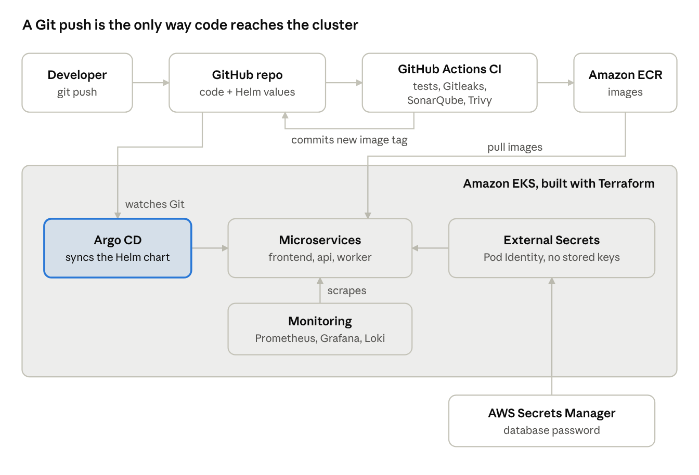

# EKS GitOps Platform with DevSecOps

Three containerised microservices running on **Amazon EKS**, with infrastructure built by **Terraform**, images built and security-scanned in **GitHub Actions**, deployments driven by **Argo CD** (GitOps), secrets pulled from **AWS Secrets Manager** through **EKS Pod Identity**, and monitoring with **Prometheus, Grafana and Loki** against a defined **SLO**.



**The key idea:** CI never touches the cluster. It builds, scans and pushes images, then commits the new image tag to Git. Argo CD notices the change in Git and makes the cluster match it. Git is the single source of truth, and every deployment is a reviewable, revertible commit.

---

## What's inside

| Area | Tools | Why this choice |
|---|---|---|
| Apps | Python (FastAPI), nginx, PostgreSQL | Small services, so the focus stays on the platform |
| Containers | Docker multi-stage builds, non-root users, read-only filesystems | Smaller images and less attack surface |
| Infrastructure as Code | Terraform with reusable modules, S3 remote state with native locking | Repeatable environments; state is shared and protected from concurrent runs |
| Network | VPC across 2 AZs, private subnets for nodes, one NAT gateway | Nodes aren't reachable from the internet; one NAT keeps cost down |
| Kubernetes | Amazon EKS managed node group (Spot), Helm chart | Managed control plane; Spot cuts node cost |
| CI | GitHub Actions: tests, Gitleaks, SonarQube Cloud (optional), Trivy, push to ECR | Security checks run before any image is published |
| CI auth | GitHub OIDC → IAM role limited to `main` of this repo | No long-lived AWS keys stored in GitHub |
| CD | Argo CD with automated sync, prune and self-heal | GitOps: deploys and rollbacks are Git commits |
| Secrets | AWS Secrets Manager + External Secrets Operator + EKS Pod Identity | No passwords in Git; least-privilege access to one secret |
| Observability | kube-prometheus-stack, Loki, Grafana Alloy, custom dashboard | Metrics, logs and alerts in one place |
| Reliability | SLO 99.5% with a multi-window fast-burn alert | Alerts on user impact, not on noise |
| Alternative CI | `Jenkinsfile` with the same stages | Shows the same pipeline in Jenkins |

## Repository layout

```
apps/                 api (FastAPI), worker, frontend (nginx) + Dockerfiles + tests
helm/shop/            Helm chart: values.yaml (local) + values-eks.yaml (EKS, tag set by CI)
infra/terraform/      bootstrap (state bucket), modules (vpc, eks, ecr), envs/dev
gitops/argocd/        Argo CD Application
monitoring/           Prometheus/Grafana, Loki and Alloy values, Grafana dashboard
.github/workflows/    CI pipeline
scripts/              local cluster, configure, platform install, load test, cleanup
docs/                 architecture, run-sheet, RCA, screenshots
```

## How to run it

Step by step: **[docs/RUNSHEET.md](docs/RUNSHEET.md)**. In short:

```bash
docker compose up --build                     # 1. run locally
./scripts/local-up.sh                         # 2. local Kubernetes (kind)
terraform -chdir=infra/terraform/envs/dev apply   # 3. AWS (after bootstrap + configure.sh)
# 4. run the GitHub Actions pipeline
./scripts/install-platform.sh                 # 5. Argo CD, External Secrets, monitoring
terraform -chdir=infra/terraform/envs/dev destroy # 6. tear down
```

## Security

- **No stored cloud credentials:** GitHub Actions uses OIDC; pods use EKS Pod Identity.
- **Least privilege:** the CI role can only push to the three ECR repositories, and only from `main`; External Secrets can read only the one database secret.
- **Pipeline gates:** Gitleaks (secrets in code), Trivy (fixable HIGH/CRITICAL CVEs fail the build), optional SonarQube Cloud (code quality).
- **Hardened containers:** non-root users, read-only root filesystems, all Linux capabilities dropped, privilege escalation blocked.
- **Immutable images:** ECR tags are immutable and set to the Git commit SHA, so every running image traces back to a commit.

## Observability and SLO

- **SLO:** 99.5% of API requests succeed over 30 days (error budget 0.5%).
- **Alert:** `ShopApiErrorBudgetFastBurn` fires when the error ratio is above 7.2% (14.4× the budget rate) over both 5 minutes and 1 hour, the multi-window approach from the Google SRE workbook. It fires fast on real incidents and ignores short blips.
- **Dashboard:** requests per second by status, error ratio, p95 latency, restarts, and live logs.

## Incident write-up

See **[docs/rca-001.md](docs/rca-001.md)**: a deliberate failure, how it was detected and investigated, the fix, and prevention actions.

## Cost

About **$0.23 per hour** while EKS is running (control plane, NAT gateway, 2 Spot nodes, public IP and disks), so roughly **$2–4** for a one-day build if everything is destroyed the same day. Left running, it would be about **$170 a month**. Prices are approximate (eu-north-1, 2026); check the AWS pricing pages.

## Problems I hit

> Add your own notes here as you build: what broke, how you found the cause, and how you fixed it. Interviewers love this section.

-

## What I'd add next

- Amazon RDS instead of in-cluster PostgreSQL
- Ingress with the AWS Load Balancer Controller, TLS from ACM, and DNS
- Karpenter for node autoscaling
- OpenTelemetry tracing
- Policy-as-code with Kyverno (e.g. block root containers)
- Separate dev and prod environments, with promotion by pull request
- Argo Rollouts for canary deployments
