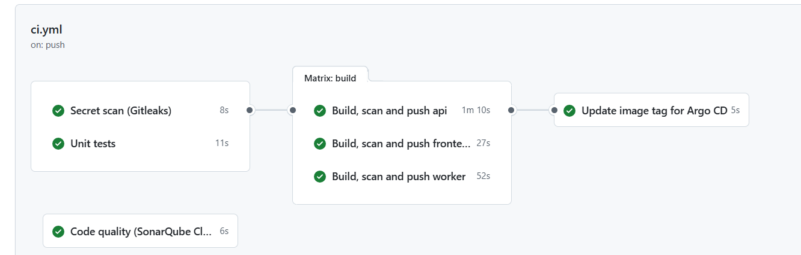
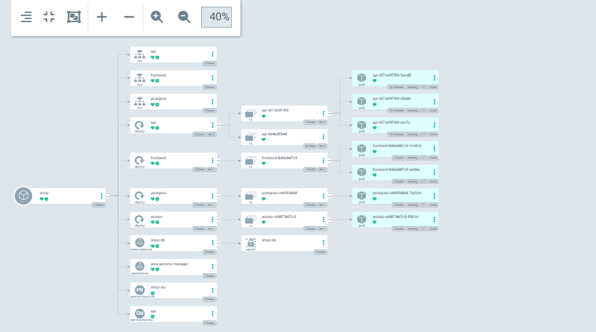
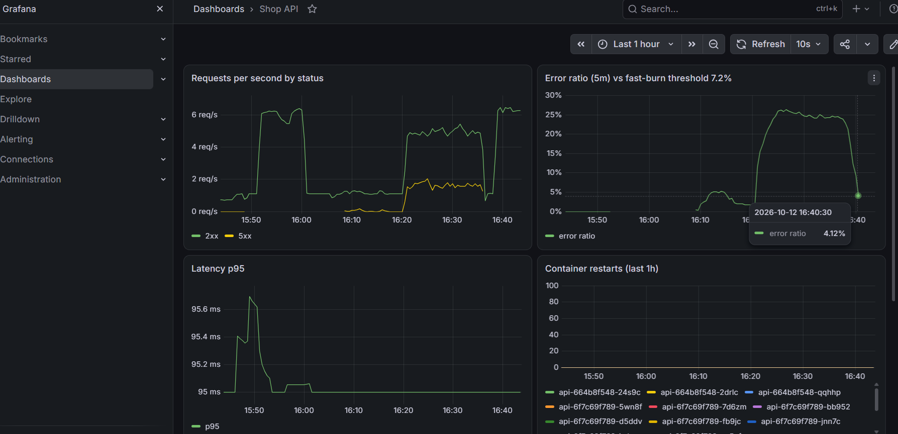
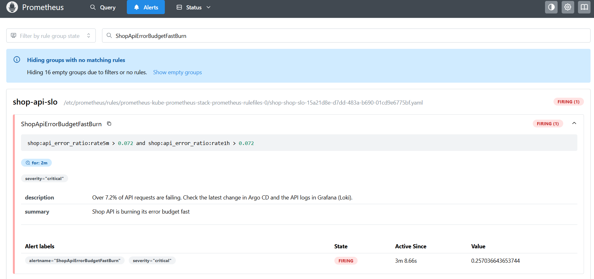

# EKS GitOps Platform with DevSecOps

Three containerised microservices running on **Amazon EKS**, with infrastructure built by **Terraform**, images built and security-scanned in **GitHub Actions**, deployments driven by **Argo CD** (GitOps), secrets pulled from **AWS Secrets Manager** through **EKS Pod Identity**, and monitoring with **Prometheus, Grafana and Loki** against a defined **SLO**.


**The key idea:** CI never touches the cluster. It builds, scans and pushes images, then commits the new image tag to Git. Argo CD notices the change in Git and makes the cluster match it. Git is the single source of truth, and every deployment is a reviewable, revertible commit.

## Results

Built, run and torn down on AWS (eu-north-1) in one day, October 2026:

- A green pipeline built 3 images, **blocked a release over 3 HIGH CVEs** until they were fixed, then pushed to ECR with immutable SHA tags.
- Argo CD deployed everything from Git; changing `replicas` in Git scaled the API, and manual `kubectl` changes were **reverted automatically** (self-heal).
- The app processed **6,200+ orders** under load on EKS.
- A deliberate bad config change caused **~25% errors**; the **SLO alert fired**, the cause was found through Grafana, Loki and Argo CD history, and a **`git revert` rolled it back** in about 2 minutes. Write-up: [RCA-001](docs/rca-001.md).

| | |
|---|---|
|  |  |
| CI: Gitleaks, tests, Trivy, push to ECR, tag update | Argo CD: the whole app synced from Git |
|  |  |
| Grafana: the incident at ~25% errors and the recovery | Prometheus: the SLO fast-burn alert firing |

More in [docs/screenshots](docs/screenshots).

---

## What's inside

| Area | Tools | Why this choice |
|---|---|---|
| Apps | Python (FastAPI), nginx, PostgreSQL | Small services, so the focus stays on the platform |
| Containers | Docker multi-stage builds, non-root users, read-only filesystems | Smaller images and less attack surface |
| Infrastructure as Code | Terraform with reusable modules, S3 remote state with native locking | Repeatable environments; state is shared and protected from concurrent runs |
| Network | VPC across 2 AZs, private subnets for nodes, one NAT gateway | Nodes aren't reachable from the internet; one NAT keeps cost down |
| Kubernetes | Amazon EKS managed node group (Spot), Helm chart | Managed control plane; Spot cuts node cost |
| CI | GitHub Actions: tests, Gitleaks, SonarQube Cloud (optional), Trivy, push to ECR | Security checks run before any image is published |
| CI auth | GitHub OIDC → IAM role limited to `main` (switchable); IAM user limited to ECR push where OIDC is blocked | Least privilege either way; see "Problems I hit" |
| CD | Argo CD with automated sync, prune and self-heal | GitOps: deploys and rollbacks are Git commits |
| Secrets | AWS Secrets Manager + External Secrets Operator + EKS Pod Identity | No passwords in Git; least-privilege access to one secret |
| Observability | kube-prometheus-stack, Loki, Grafana Alloy, custom dashboard | Metrics, logs and alerts in one place |
| Reliability | SLO 99.5% with a multi-window fast-burn alert | Alerts on user impact, not on noise |
| Alternative CI | `Jenkinsfile` with the same stages | Shows the same pipeline in Jenkins |

## Repository layout

```
apps/                 api (FastAPI), worker, frontend (nginx) + Dockerfiles + tests
helm/shop/            Helm chart: values.yaml (local) + values-eks.yaml (EKS, tag set by CI)
infra/terraform/      bootstrap (state bucket), modules (vpc, eks, ecr), envs/dev
gitops/argocd/        Argo CD Application
monitoring/           Prometheus/Grafana, Loki and Alloy values, Grafana dashboard
.github/workflows/    CI pipeline
scripts/              local cluster, configure, platform install, load test, cleanup
docs/                 architecture, run-sheet, RCA, screenshots
```

## How to run it

 In short:

```bash
docker compose up --build                     # 1. run locally
./scripts/local-up.sh                         # 2. local Kubernetes (kind)
terraform -chdir=infra/terraform/envs/dev apply   # 3. AWS (after bootstrap + configure.sh)
# 4. run the GitHub Actions pipeline
./scripts/install-platform.sh                 # 5. Argo CD, External Secrets, monitoring
terraform -chdir=infra/terraform/envs/dev destroy # 6. tear down
```

## Security

- **No keys in the cluster:** pods get AWS access through EKS Pod Identity.
- **CI credentials:** GitHub OIDC where the account allows it (`use_github_oidc = true`); otherwise an IAM user whose only permission is pushing to the three ECR repositories, with its key in GitHub encrypted secrets and deleted after use.
- **Least privilege:** External Secrets can read only the one database secret.
- **Pipeline gates:** Gitleaks (secrets in code), Trivy (fixable HIGH/CRITICAL CVEs fail the build), optional SonarQube Cloud (code quality).
- **Hardened containers:** non-root users, read-only root filesystems, all Linux capabilities dropped, privilege escalation blocked.
- **Immutable images:** ECR tags are immutable and set to the Git commit SHA, so every running image traces back to a commit.

## Observability and SLO

- **SLO:** 99.5% of API requests succeed over 30 days (error budget 0.5%).
- **Alert:** `ShopApiErrorBudgetFastBurn` fires when the error ratio is above 7.2% (14.4× the budget rate) over both 5 minutes and 1 hour, the multi-window approach from the Google SRE workbook. It fires fast on real incidents and ignores short blips.
- **Dashboard:** requests per second by status, error ratio, p95 latency, restarts, and live logs.

## Incident write-up

See **[docs/rca-001.md](docs/rca-001.md)**: a deliberate failure, how it was detected and investigated, the fix, and prevention actions.

## Cost

About **$0.23 per hour** while EKS is running (control plane, NAT gateway, 2 Spot nodes, public IP and disks). The real build ran EKS for about 3.5 hours, a few dollars in total, because everything was destroyed the same day. Left running, it would be about **$170 a month**. Prices are approximate (eu-north-1, 2026).

## Problems I hit

| Problem | Cause | Fix |
|---|---|---|
| `terraform apply` failed creating IAM OIDC providers (403 AccessDenied) | The AWS account's service control policy denies `iam:CreateOpenIDConnectProvider` | Turned off IRSA (`enable_irsa = false`) and used **EKS Pod Identity** for pods; for CI, a least-privilege IAM user, with OIDC kept as a switchable option |
| Resources could not be created in eu-west-1 | The account type is locked to one region (eu-north-1) | Moved everything to eu-north-1; the region is a variable throughout |
| **Trivy failed the api build** | 3 HIGH CVEs in `starlette` 0.46.2 (CVE-2025-62727, CVE-2026-48818, CVE-2026-54283) | Upgraded FastAPI so Starlette moved to 1.7.0; did not weaken the scan |
| Unit tests failed only in CI (`ModuleNotFoundError: app`) | `pytest` does not add the working directory to the import path | Added `pytest.ini` with `pythonpath = .` |
| One failed matrix build cancelled the other two | GitHub's default `fail-fast: true` | Set `fail-fast: false` so each service reports independently |
| `Permission denied` running scripts | Executable bits were lost when files passed through Windows | `chmod +x` and committed the mode change |
| SLO alert did not fire after the bad deploy | The load generator had stopped, so there was no traffic to fail | Restarted traffic; prevention action in the RCA: add a synthetic probe |
| Worker exits with code 137 on shutdown | The Python process runs as PID 1 and ignores SIGTERM, so it is force-killed after the grace period | Open: add a SIGTERM handler (or `tini`) so pods stop cleanly |

## What I'd add next

- Amazon RDS instead of in-cluster PostgreSQL
- Ingress with the AWS Load Balancer Controller, TLS from ACM, and DNS
- Karpenter for node autoscaling
- OpenTelemetry tracing
- Policy-as-code with Kyverno (e.g. block root containers)
- Separate dev and prod environments, with promotion by pull request
- Argo Rollouts for canary deployments
